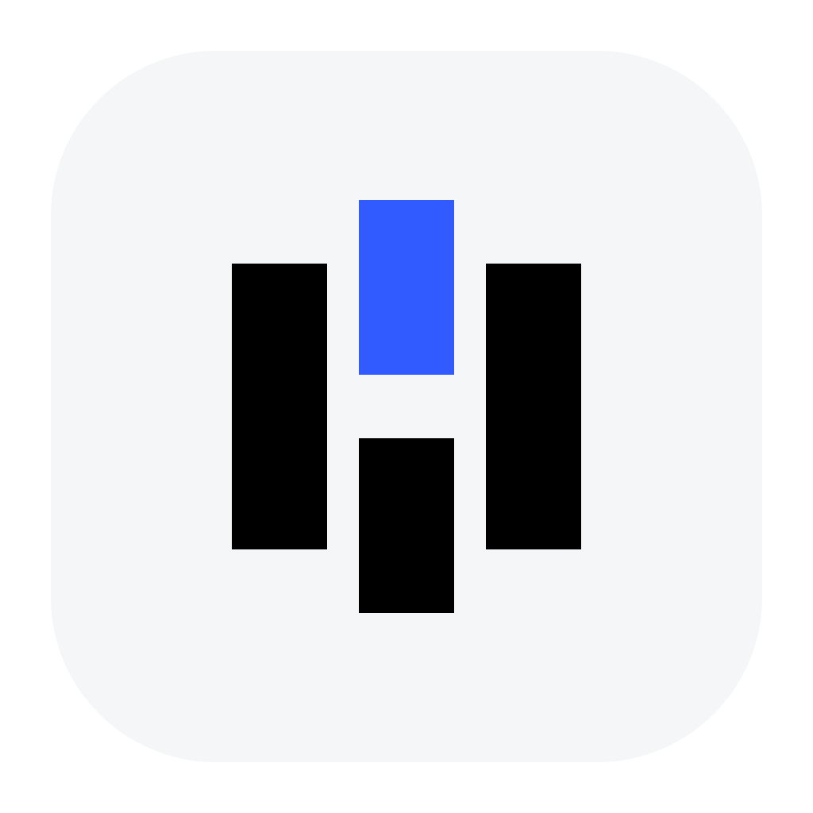
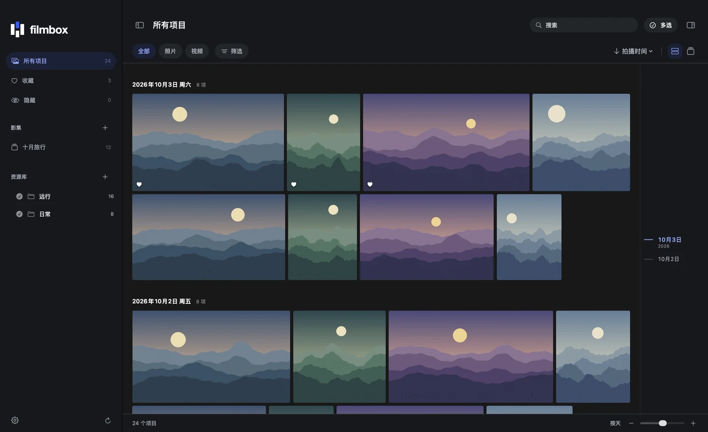
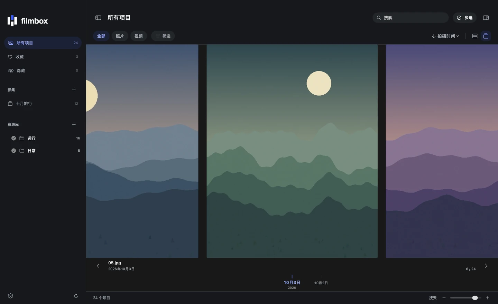
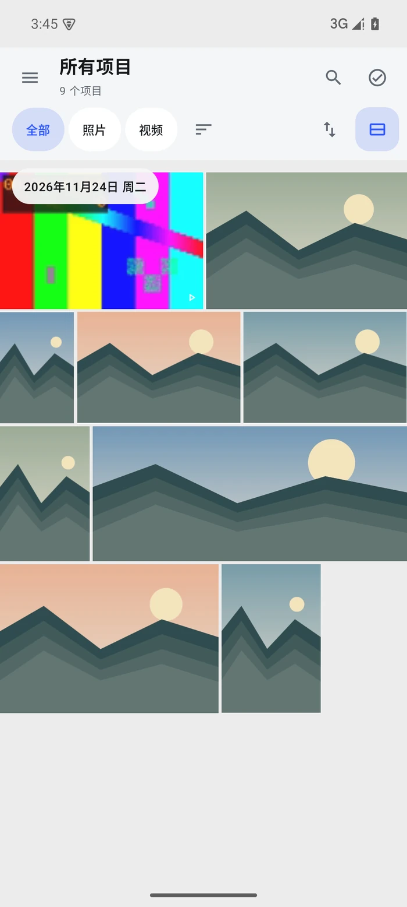
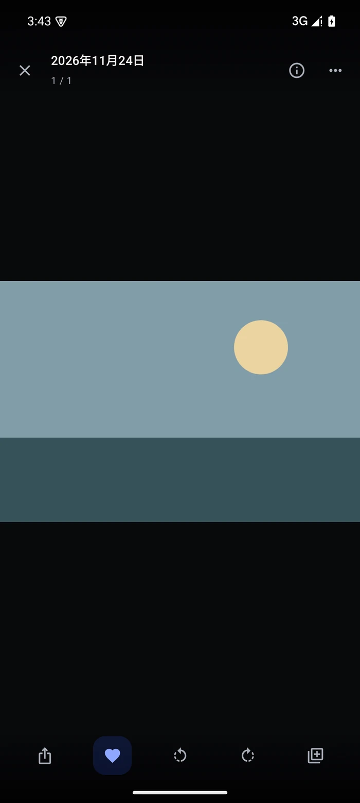

  

<h1 align="center">菲林盒 · Filmbox</h1>

把散落在本地和云端的照片、视频，放回一条时间线。

  <!-- repository-badges:start -->
  
  <!-- repository-badges:end -->
  
  
  

  <a href="https://ooooyasumi.com/products/filmbox/">产品网站（待上线）</a> ·
  <a href="#下载与安装">下载与安装</a> ·
  <a href="docs/USAGE.md">使用手册</a> ·
  <a href="#参与贡献">参与贡献</a>

## 浏览与整理

- **本地与云端一起看**。把本地文件夹和网盘目录加为资源库，在「所有项目」里一起按日期浏览。
- **按原比例铺开**。横幅、竖幅和全景各自保留构图。用日期尺跳到想看的时间，或在 Android 上双指缩放照片流。
- **像翻胶片一样回看**。横向连续翻阅照片和视频，也能用收藏、隐藏和影集整理素材。

查看胶片翻阅与 Android 截图

<strong>macOS · 胶片翻阅</strong>

<strong>Android · 照片流和查看器</strong>

  
  

截图来自实际客户端界面，使用合成示例素材。

## 下载与安装

| 平台 | 当前版本 | 系统要求 | 指引 |
| --- | --- | --- | --- |
| macOS | **0.6.26** | Apple Silicon（arm64），macOS 15+ | [安装说明](docs/INSTALL.md#macos) · [更新记录](CHANGELOG.md) |
| Android | **0.4.1** | Android 11+（API 30），arm64 | [安装说明](docs/INSTALL.md#android) · [更新记录](Android/CHANGELOG.md) |

<!-- public-links:start -->
公开安装包与校验值将在仓库的 Releases 页面提供。
<!-- public-links:end -->

macOS 公开安装包仍待 Developer ID 签名与 Apple 公证。开发构建可参考[构建说明](docs/BUILD.md)。

## 开始使用

1. 在 Mac 上点资源库旁的「＋」选择文件夹。在 Android 上授权系统相册，或用文件选择器添加目录。
2. 想看网盘里的照片时，从云盘入口连接账号并选择目录。首次索引完成后即可按时间浏览。
3. 在时间线和胶片翻阅间切换，或打开查看器看大图和视频。云端预览按需加载，原图在查看或手动下载时获取。

百度和夸克属于实验接入，双端真实账号测试仍待完成。NAS 接入需要 WebDAV，Android 要求 HTTPS。收藏、隐藏和影集保存在当前设备，云端文件目前只读。详情见[平台能力与测试状态](docs/CAPABILITIES.md)。

## 从源码构建

| 组件 | 代码 | 说明 |
| --- | --- | --- |
| macOS 客户端 | [Sources](Sources) · Swift / SwiftUI / AppKit | [构建指南](docs/BUILD.md) |
| Android 客户端 | [Android](Android) · Kotlin / Jetpack Compose | [构建指南](Android/README.md) |
| 云盘引擎 | [CloudEngine](CloudEngine) · Go | [组件说明](docs/CLOUD_ENGINE.md) |

## 参与贡献

如果菲林盒对你有用，欢迎在 GitHub 点个 **Star**。遇到问题可到仓库的 **Issues** 提交，附上平台、版本和复现步骤。提交截图或日志前，请移除私人照片、路径和账号凭据。

[贡献指南](CONTRIBUTING.md) · [安全反馈](SECURITY.md) · [发布检查清单](docs/RELEASE.md) · [实际验收记录](docs/OPEN_SOURCE_ACCEPTANCE.md)

## 许可证与隐私

菲林盒自有代码采用 [AGPL-3.0-only](LICENSE)。CloudEngine、FFmpeg 和 Android 依赖的许可及归属见[第三方声明](THIRD_PARTY_NOTICES.md)。了解本机数据、网盘授权和缓存清理，请阅读[隐私说明](PRIVACY.md)。
